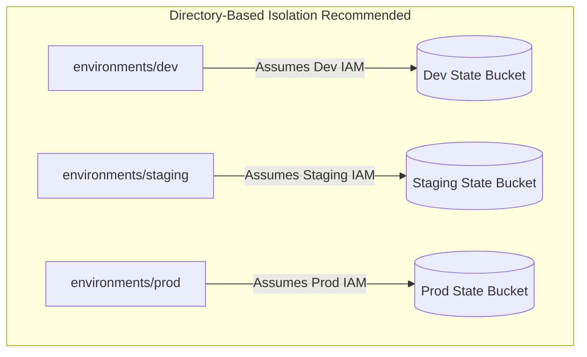

# Workspace strategy and environment isolation

## Objectives and prerequisites

Evaluate environment isolation strategies, understand the difference between Terraform CLI workspaces and directory-based isolation, and structure multi-account architectures. Prerequisites: [state management](../state/state-management.md), [remote backends](../state/remote-backends.md), and [naming conventions](naming-conventions.md).

## What are Terraform CLI workspaces

Terraform CLI workspaces allow managing multiple state files from a single working directory:
- Commands: `terraform workspace new dev`, `terraform workspace select prod`, `terraform workspace list`.
- State paths: In remote backends (e.g., S3), state is segregated under a workspace prefix (e.g., `env:/dev/terraform.tfstate`, `env:/prod/terraform.tfstate`).
- Interpolation: The current workspace name is accessible via `terraform.workspace`.

```hcl
resource "terraform_data" "env_label" {
  input = {
    tier = terraform.workspace
  }
}
```

## CLI workspaces vs. Directory-based isolation

A critical architectural decision in Terraform is choosing between CLI workspaces and directory-based environment separation:

| Architecture Dimension | CLI Workspaces (`terraform workspace`) | Directory / Root Isolation (`environments/dev`, `environments/prod`) |
| --- | --- | --- |
| **Code Sharing** | 100% identical HCL configuration | Modules shared; roots configure distinct inputs |
| **Blast Radius** | High: same backend storage and IAM credentials | Minimal: separate AWS accounts / Azure subscriptions |
| **Configuration Drift** | High: `terraform.workspace` conditionals proliferate | Low: explicit `.tfvars` and parameter files |
| **IAM Separation** | Difficult: deployment runner needs access to all tiers | Clean: distinct IAM roles per environment |
| **Recommended Use** | Ephemeral feature branches, dev sandboxes | Production enterprise multi-tier environments |



## HCP Terraform / Terraform Enterprise workspaces

In HCP Terraform (formerly Terraform Cloud) or Terraform Enterprise, a **workspace** is a distinct architectural entity:
- Each HCP workspace is bound to a specific repository branch, environment variables, cloud credentials, and state file.
- It provides team access controls, concurrency locking, and speculative plans on pull requests.
- Unlike CLI workspaces, HCP workspaces are the recommended standard for separating environments in hosted platforms.

## Multi-account and multi-subscription isolation

Enterprise best practice dictates isolating environments by cloud account / project boundary:
1. **AWS**: Separate AWS Accounts for `development`, `staging`, `production`, and `security/audit` managed under AWS Organizations.
2. **Azure**: Separate Azure Subscriptions under an Enterprise Agreement or Management Group hierarchy.
3. **Google Cloud**: Separate Google Cloud Projects (`myorg-app-dev`, `myorg-app-prod`) under a centralized Organization folder structure.

Never use the same cloud account or state bucket for development and production workloads.

## Exercise and expected result

Experiment with CLI workspace creation in a local environment:

```shell
terraform workspace list
terraform workspace new test-tier
terraform workspace show
terraform workspace select default
terraform workspace delete test-tier
```

Verify that switching workspaces changes the state context and that workspaces can only be deleted when not currently selected.

Rationale: Understanding how workspaces alter the active state pointer prevents applying changes against the wrong environment.

## Troubleshooting and cleanup

| Symptom | Cause | Remediation |
| --- | --- | --- |
| `Cannot delete workspace default` | The default workspace is protected | Switch to another workspace before deleting custom workspaces |
| Applied dev changes to production | Selected wrong CLI workspace before `terraform apply` | Use directory-based isolation or distinct CI runner roles for production |
| Inconsistent resources between tiers | Overuse of complex `terraform.workspace == "prod" ? ...` ternaries | Refactor into shared child modules called by distinct environment roots |

## References and verification

Reviewed 2026-10-11 for Terraform 1.14.8; see [curriculum evidence](../docs/curriculum-evidence.md).
- [Terraform Workspaces](https://developer.hashicorp.com/terraform/language/state/workspaces)
- [HCP Terraform Workspaces](https://developer.hashicorp.com/terraform/cloud-docs/workspaces)
- [AWS Multi-Account Architecture](https://docs.aws.amazon.com/whitepapers/latest/organizing-your-aws-environment/organizing-your-aws-environment.html)