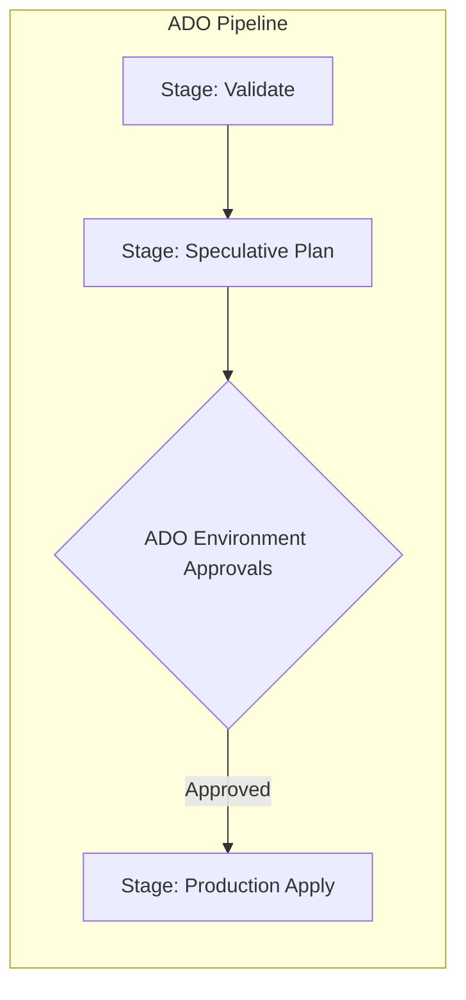

# Terraform automation with Azure DevOps pipelines

## Objectives and prerequisites

Implement enterprise Terraform deployment pipelines in Azure DevOps (ADO), configure Workload Identity federation with Azure Service Connections, structure reusable YAML templates, and enforce environment approvals. Prerequisites: [github-actions](github-actions.md) and [remote-backends](../state/remote-backends.md).

## Pipeline structure and YAML templates

In Azure DevOps, structure deployment pipelines using multi-stage YAML pipelines and reusable template files:



A robust directory layout separates pipeline definitions from infrastructure code:
- `.azure-pipelines/templates/terraform-init.yml`
- `.azure-pipelines/templates/terraform-plan.yml`
- `.azure-pipelines/templates/terraform-apply.yml`
- `azure-pipelines.yml` (Main pipeline entrypoint)

## Azure Service Connections and Workload Identity

Modern Azure DevOps integrates with Microsoft Entra ID using **Workload Identity Federation** (OpenID Connect), eliminating the need to store client secrets or certificates in Service Connections:
1. In Azure DevOps Project Settings, create an **Azure Resource Manager** Service Connection.
2. Select **Workload Identity federation (automatic)**.
3. Azure registers an Application in Entra ID and configures a Federated Identity Credential matching the ADO Organization, Project, and Pipeline.
4. The pipeline uses the `AzureCLI@2` task to authenticate seamlessly.

Sample YAML task using federated authentication:

```yaml
steps:
  - task: AzureCLI@2
    displayName: 'Terraform Plan via Workload Identity'
    inputs:
      azureSubscription: 'prod-service-connection'
      scriptType: 'bash'
      scriptLocation: 'inlineScript'
      inlineScript: |
        export ARM_USE_OIDC=true
        export ARM_CLIENT_ID=$servicePrincipalId
        export ARM_TENANT_ID=$tenantId
        export ARM_SUBSCRIPTION_ID=$(az account show --query id -o tsv)
        
        terraform init
        terraform plan -out=$(Build.ArtifactStagingDirectory)/tfplan.binary
```

## Approvals, checks, and release stages

Azure DevOps utilizes **Environments** to gate production deployments:
1. Define an Environment named `production` under **Pipelines -> Environments**.
2. Configure **Approvals and Checks** on the Environment (e.g., Designated human approvers, business hours checks, required template checks).
3. In YAML, define the apply job as a `deployment` job targeting that Environment:

```yaml
stages:
  - stage: Apply
    dependsOn: Plan
    jobs:
      - deployment: ApplyInfrastructure
        environment: 'production'
        strategy:
          runOnce:
            deploy:
              steps:
                - task: AzureCLI@2
                  inputs:
                    azureSubscription: 'prod-service-connection'
                    scriptType: 'bash'
                    scriptLocation: 'inlineScript'
                    inlineScript: |
                      terraform apply -input=false $(Build.ArtifactStagingDirectory)/tfplan.binary
```

## Exercise and expected result

Evaluate pipeline identity patterns:
- Compare static service principal secrets (stored in Key Vault) versus Workload Identity federation.
- Verify that federated credentials have no expiration date to manage and cannot be exfiltrated for use outside Azure DevOps.

Rationale: Workload Identity Federation aligns Azure DevOps with zero-trust architectural principles.

## Troubleshooting and cleanup

| Symptom | Cause | Remediation |
| --- | --- | --- |
| `AADSTS700016: Application with identifier ... was not found` | Entra ID application registration was deleted or misconfigured | Re-create or verify the Service Connection federation settings in ADO |
| `Job paused awaiting approval` | Normal ADO behavior on protected Environments | An authorized reviewer must approve the deployment in the ADO web portal |
| `Error acquiring storage blob lease` | AzureRM remote backend lease held by another run | Verify running ADO stages; avoid parallel runs targeting the same state key |

## References and verification

Reviewed 2026-10-11 for Terraform 1.14.8; see [curriculum evidence](../docs/curriculum-evidence.md).
- [Azure DevOps Workload Identity Federation](https://learn.microsoft.com/en-us/azure/devops/pipelines/library/connect-to-azure-workload-identity)
- [Azure Pipelines YAML Schema](https://learn.microsoft.com/en-us/azure/devops/pipelines/yaml-schema/)
- [Terraform AzureRM Backend](https://developer.hashicorp.com/terraform/language/v1.14.x/backend/azurerm)