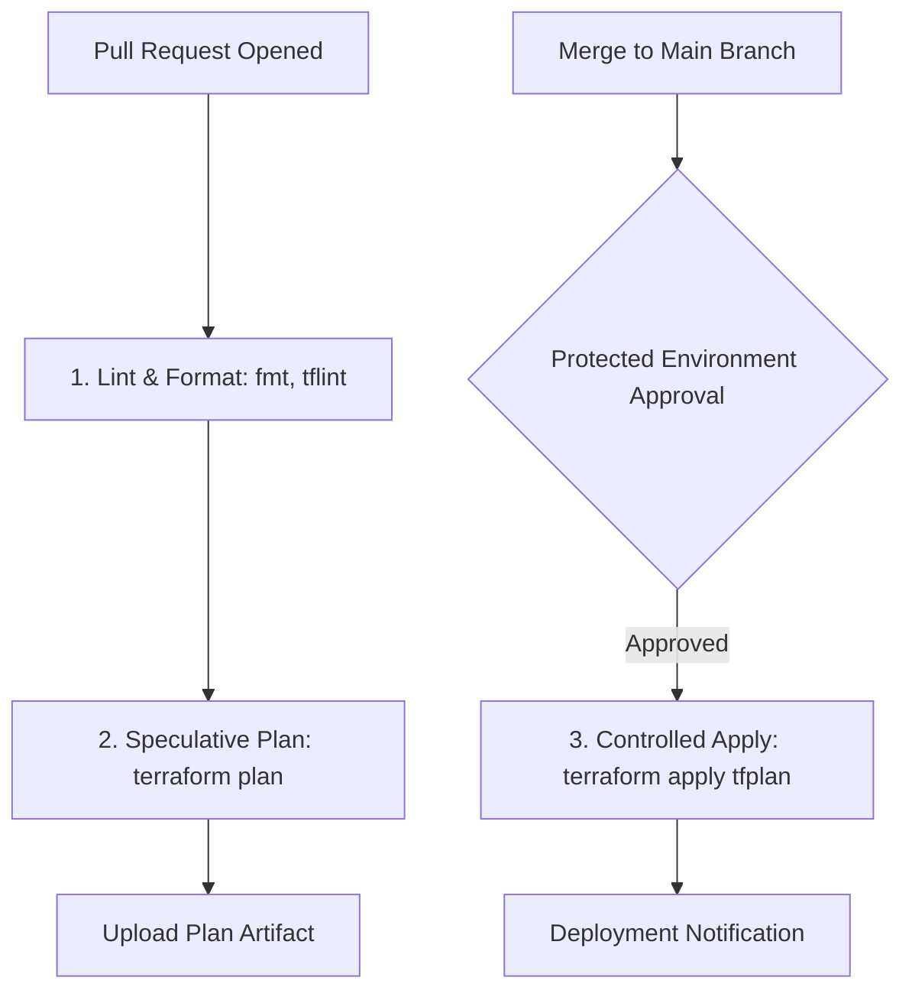

# Terraform CI/CD pipelines with GitHub Actions

## Objectives and prerequisites

Design a hardened, multi-stage GitHub Actions pipeline for Terraform, integrate OIDC authentication for AWS/Azure/GCP, manage state locks and plan artifacts, and prevent concurrency race conditions. Prerequisites: [terraform validate and plan](../testing/terraform-validate-and-plan.md) and [secrets management](../security/secrets-management.md).

## Pipeline security and architecture

A production Terraform pipeline separates untrusted speculative validation from protected state mutation:



Key security principles:
1. **Explicit Permissions**: Enforce `permissions: contents: read` globally. Only grant `id-token: write` on specific OIDC deployment jobs.
2. **Pinned Action SHAs**: Pin third-party actions to full 40-character commit hashes rather than mutable branch or tag names.
3. **Disable Persisted Credentials**: Set `persist-credentials: false` in `actions/checkout`.
4. **Environment Protection Rules**: Require designated human reviewers on protected GitHub environments (e.g., `production`) before apply steps execute.

## Multi-stage workflow design

Sample hardened workflow configuration:

```yaml
name: Terraform Pipeline
on:
  pull_request:
    branches: [main]
  push:
    branches: [main]

permissions:
  contents: read

concurrency:
  group: terraform-${{ github.ref }}
  cancel-in-progress: false # Never cancel mid-apply

jobs:
  validate:
    runs-on: ubuntu-latest
    timeout-minutes: 5
    steps:
      - uses: actions/checkout@11bd71901bbe5b1630ceea73d27597364c9af683 # v4.2.2
        with:
          persist-credentials: false
      - uses: hashicorp/setup-terraform@b9cd54a3c349d3f38e8881555d616ced269862dd # v3.1.2
        with:
          terraform_version: 1.14.8
      - run: terraform fmt -check
      - run: terraform init -backend=false
      - run: terraform validate
```

## OIDC authentication without long-lived keys

Configure OpenID Connect (OIDC) to assume cloud roles dynamically:

```yaml
  plan:
    needs: validate
    runs-on: ubuntu-latest
    permissions:
      contents: read
      id-token: write
    steps:
      - uses: actions/checkout@11bd71901bbe5b1630ceea73d27597364c9af683 # v4.2.2
      - name: Configure AWS Credentials
        uses: aws-actions/configure-aws-credentials@e3dd6a429d7300a6a4c196c26e071d42e0343502 # v4.0.2
        with:
          role-to-assume: arn:aws:iam::123456789012:role/GitHubTerraformPlanRole
          aws-region: us-east-1
      - run: terraform init
      - run: terraform plan -out=tfplan.binary
```

## Concurrency, locking, and artifact handling

1. **Serialize Deployment Jobs**: Set `cancel-in-progress: false` on apply workflows to avoid terminating an active `terraform apply` mid-execution, which risks state lock deadlocks or orphaned resources.
2. **Ephemeral Plan Storage**: When uploading `tfplan.binary` between jobs, set a short retention window (e.g., `retention-days: 1`) and ensure plan artifacts are restricted to protected repository environments.
3. **Locking Safeguards**: Never pass `-lock=false` in CI pipelines. If a job crashes, require an operations engineer to verify whether resources were altered before executing `terraform force-unlock`.

## Exercise and expected result

Inspect the repository's active workflow at [.github/workflows/docs.yml](../.github/workflows/docs.yml):

```shell
node scripts/check-security.mjs
```

Verify that the workflow passes all security checks:
- Immutable commit hashes on all action references.
- Read-only contents permission.
- Bounded timeouts on all jobs.
- Disabled checkout credentials.

Rationale: Enforcing strict workflow policies prevents CI runner supply-chain attacks and credential exfiltration.

## Troubleshooting and cleanup

| Symptom | Cause | Remediation |
| --- | --- | --- |
| `Error: OIDC token minting failed` | Job lacks `id-token: write` permission | Add `permissions: id-token: write` to the job block |
| `Error acquiring the state lock` | Previous run died unexpectedly or another pipeline is applying | Check running jobs; only unlock after confirming no apply is running |
| `Action not found or tag altered` | Action author altered or deleted tag | Pin to immutable 40-character commit SHAs |

## References and verification

Reviewed 2026-10-11 for Terraform 1.14.8; see [curriculum evidence](../docs/curriculum-evidence.md).
- [GitHub Actions OIDC](https://docs.github.com/en/actions/deployment/security-hardening-your-deployments/about-security-hardening-with-openid-connect)
- [HashiCorp setup-terraform Action](https://github.com/hashicorp/setup-terraform)
- [Managing Concurrency in Workflows](https://docs.github.com/en/actions/writing-workflows/choosing-what-your-workflow-does/control-the-concurrency-of-workflows-and-jobs)