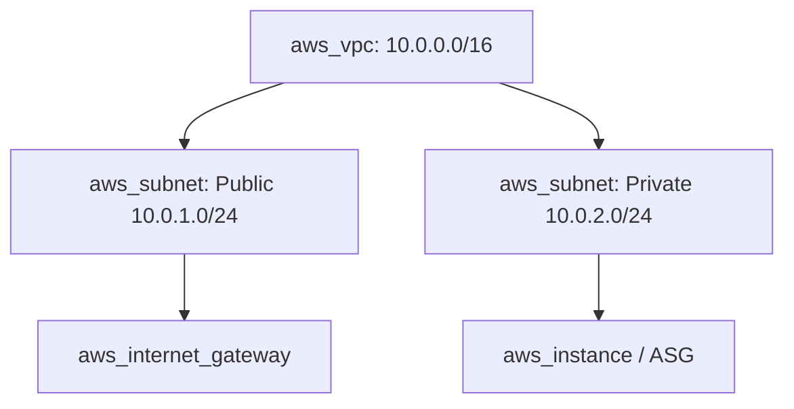

# Terraform on Amazon Web Services (AWS)

## Objectives and prerequisites

Authenticate and configure the AWS provider, establish an encrypted S3 state backend with state locking, declare foundational network/compute resources, and enforce clean teardowns. Prerequisites: [providers and resources](../core-concepts/providers-and-resources.md) and [remote backends](../state/remote-backends.md). AWS CLI and an active AWS account required for live deployment.

## AWS provider architecture and authentication

The HashiCorp AWS provider communicates with AWS REST APIs via the AWS SDK:

```hcl
terraform {
  required_version = "~> 1.14.0"
  required_providers {
    aws = {
      source  = "hashicorp/aws"
      version = "~> 5.80.0"
    }
  }
}

provider "aws" {
  region = var.aws_region

  default_tags {
    tags = {
      Environment = var.environment
      ManagedBy   = "terraform"
      Project     = "terraform-guide"
    }
  }
}
```

Recommended authentication methods:
- **Local Development**: AWS IAM Identity Center (SSO) via `aws sso login` or temporary session tokens via AWS CLI.
- **CI/CD Pipelines**: OpenID Connect (OIDC) role assumption via GitHub Actions / GitLab CI. Never hardcode access keys in HCL.

## State backend on AWS: S3 and DynamoDB

For production state storage, use an S3 bucket with versioning and encryption:

```hcl
terraform {
  backend "s3" {
    bucket       = "myorg-tfstate-us-east-1"
    key          = "prod/vpc/terraform.tfstate"
    region       = "us-east-1"
    encrypt      = true
    use_lockfile = true # Terraform 1.10+ native S3 lockfile support
  }
}
```

Key controls:
- **Server-Side Encryption**: Enable KMS customer-managed key (SSE-KMS) or AES-256.
- **Versioning**: Enable S3 Bucket Versioning to support rollbacks.
- **Block Public Access**: Enable `BlockPublicAcls`, `BlockPublicPolicy`, `IgnorePublicAcls`, and `RestrictPublicBuckets`.

## Core resource modeling: VPC, IAM, and Compute

Foundational AWS resource patterns:



Use `aws_iam_role` with an `aws_iam_instance_profile` to grant EC2 instances permissions without embedding long-lived AWS credentials on the virtual machine.

## Cost drivers, teardown, and residual checks

Common unexpected AWS cost drivers during labs:
- **NAT Gateways**: Billed hourly regardless of traffic (~$32/month per NAT gateway).
- **Elastic IPs (EIP)**: Charged when unattached to a running instance.
- **Load Balancers (ALB/NLB)**: Hourly base charge plus LCU metrics.
- **EBS Volumes**: Unattached volumes left behind after instance termination.

Always run `terraform destroy` when completing learning labs. Check the AWS Cost Management Console and run `aws ec2 describe-nat-gateways` or `aws ec2 describe-volumes --filters Name=status,Values=available` to verify zero residual resources.

## Exercise and expected result

Validate AWS provider syntax and schema requirements without acquiring cloud credentials:

```shell
terraform fmt -check
```

Review the reference partial configuration in [examples/backends/s3.hcl.example](../examples/backends/s3.hcl.example). Rationale: Partial backend files decouple environment-specific bucket names from reusable module definitions. For a complete sandbox reference lab with mandatory governance tags and teardown automation, see [examples/cloud-labs/aws](../examples/cloud-labs/aws/README.md) and [cloud lab contracts](../docs/cloud-lab-contracts.md).

## Troubleshooting and cleanup

| Symptom | Cause | Remediation |
| --- | --- | --- |
| `NoValidCredentialSources` | AWS CLI not logged in or missing environment variables | Run `aws sso login` or set `AWS_PROFILE` |
| `BucketAlreadyExists` | S3 bucket name is globally taken by another AWS account | Choose a unique bucket name prefix |
| `DependencyViolation` during destroy | Security group or VPC has unmanaged resources attached | Delete orphaned ENIs or resources before re-running destroy |

## References and verification

Reviewed 2026-10-11 for Terraform 1.14.8; see [curriculum evidence](../docs/curriculum-evidence.md).
- [AWS Provider Documentation](https://registry.terraform.io/providers/hashicorp/aws/latest/docs)
- [Terraform S3 Backend](https://developer.hashicorp.com/terraform/language/v1.14.x/backend/s3)
- [AWS Default Tags](https://developer.hashicorp.com/terraform/tutorials/aws/aws-default-tags)