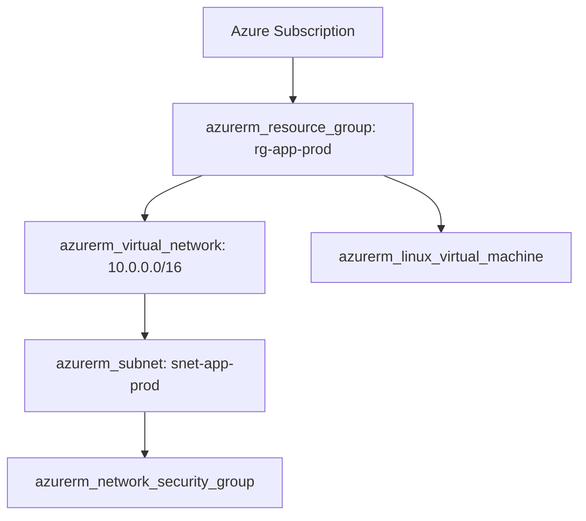

# Terraform on Microsoft Azure

## Objectives and prerequisites

Authenticate and configure the AzureRM provider, establish an Azure Blob Storage backend with native blob leasing, provision Resource Groups and Virtual Networks, and verify clean resource teardowns. Prerequisites: [providers and resources](../core-concepts/providers-and-resources.md) and [remote backends](../state/remote-backends.md). Azure CLI (`az`) and an active Azure subscription required for live deployment.

## AzureRM provider architecture and authentication

The AzureRM provider communicates with Azure Resource Manager REST APIs. Unlike other providers, the `features {}` block is mandatory:

```hcl
terraform {
  required_version = "~> 1.14.0"
  required_providers {
    azurerm = {
      source  = "hashicorp/azurerm"
      version = "~> 4.14.0"
    }
  }
}

provider "azurerm" {
  features {}

  subscription_id = var.azure_subscription_id
}
```

Authentication mechanisms:
- **Local Development**: Azure CLI session via `az login`.
- **Automated Pipelines**: Microsoft Entra ID Workload Identity Federation (OIDC) or Service Principal with client certificate/secret.

## State backend on Azure: Blob Storage

Store Terraform state in an Azure Storage Account container:

```hcl
terraform {
  backend "azurerm" {
    resource_group_name  = "rg-terraform-state"
    storage_account_name = "stterraformstateprod"
    container_name       = "tfstate"
    key                  = "prod/network.terraform.tfstate"
    use_azuread_auth     = true # Use Entra ID RBAC instead of storage account access keys
  }
}
```

Key features:
- **Native Blob Lease Locking**: Azure Blob Storage automatically provides atomic distributed locking via blob leases during `terraform plan` and `terraform apply`.
- **Entra ID RBAC**: Setting `use_azuread_auth = true` allows scoping access to the `Storage Blob Data Contributor` role without exposing the storage account master access keys.

## Core resource modeling: Resource Groups, VNet, and Entra ID

In Azure, all resources must reside within an `azurerm_resource_group`:



Use `azurerm_user_assigned_identity` to grant VMs managed identities for accessing Azure Key Vault or Storage Accounts without storing credentials on the instance.

## Cost drivers, teardown, and residual checks

Common Azure cost drivers during learning labs:
- **Virtual Network Gateways**: Azure VPN / ExpressRoute gateways have significant hourly minimum charges.
- **Application Gateways**: Minimum capacity units and public IP addresses.
- **Unmanaged Disks & Public IPs**: OS and data disks left orphaned after virtual machine deletion.

Always destroy resources with `terraform destroy`. Verify in the Azure CLI:
```shell
az resource list --resource-group rg-app-prod --output table
```
If the entire resource group was managed by Terraform, destroying the resource group guarantees deletion of all contained child resources.

## Exercise and expected result

Inspect Azure backend configuration syntax:

```shell
terraform fmt -check
```

Review [examples/backends/azurerm.hcl.example](../examples/backends/azurerm.hcl.example). Rationale: Partial configuration allows developers to target their own storage account during development while CI targets production containers. For a complete sandbox reference lab with mandatory governance tags and teardown automation, see [examples/cloud-labs/azure](../examples/cloud-labs/azure/README.md) and [cloud lab contracts](../docs/cloud-lab-contracts.md).

## Troubleshooting and cleanup

| Symptom | Cause | Remediation |
| --- | --- | --- |
| `features block is required` | Missing mandatory `features {}` in `provider "azurerm"` | Add `features {}` block to provider definition |
| `AuthorizationFailed: Does not have authorization to perform action` | Entra ID role missing on subscription or resource group | Grant `Contributor` or scoped custom role to deployment principal |
| `Storage Account name is invalid` | Name contains hyphens, capital letters, or is > 24 chars | Use 3–24 lowercase letters and numbers only |

## References and verification

Reviewed 2026-10-11 for Terraform 1.14.8; see [curriculum evidence](../docs/curriculum-evidence.md).
- [AzureRM Provider Documentation](https://registry.terraform.io/providers/hashicorp/azurerm/latest/docs)
- [Terraform AzureRM Backend](https://developer.hashicorp.com/terraform/language/v1.14.x/backend/azurerm)
- [Azure Naming Rules and Restrictions](https://learn.microsoft.com/en-us/azure/azure-resource-manager/management/resource-name-rules)