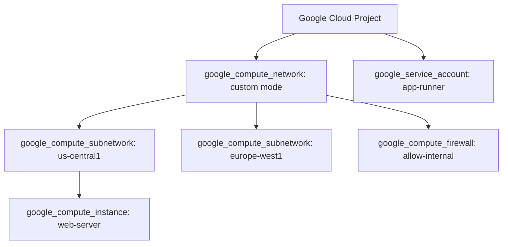

# Terraform on Google Cloud Platform (GCP)

## Objectives and prerequisites

Authenticate and configure the Google provider, establish a Google Cloud Storage (GCS) state backend, provision VPC networks and Service Accounts, and verify clean teardowns. Prerequisites: [providers and resources](../core-concepts/providers-and-resources.md) and [remote backends](../state/remote-backends.md). Google Cloud SDK (`gcloud`) and a GCP project with billing enabled required for live deployment.

## Google provider architecture and authentication

The Google provider interacts with Google Cloud Resource Manager, Compute Engine, and IAM APIs:

```hcl
terraform {
  required_version = "~> 1.14.0"
  required_providers {
    google = {
      source  = "hashicorp/google"
      version = "~> 6.14.0"
    }
  }
}

provider "google" {
  project = var.gcp_project_id
  region  = var.gcp_region
  zone    = var.gcp_zone

  default_labels = {
    environment = var.environment
    managed_by  = "terraform"
    project     = "terraform-guide"
  }
}
```

Recommended authentication methods:
- **Local Development**: Application Default Credentials (ADC) via `gcloud auth application-default login`.
- **CI/CD Pipelines**: Workload Identity Federation (WIF) binding the GitHub Actions token directly to a Google Cloud Service Account without exporting static JSON service account keys.

## State backend on GCP: Google Cloud Storage (GCS)

Store Terraform state in an encrypted GCS bucket:

```hcl
terraform {
  backend "gcs" {
    bucket = "myorg-tfstate-prod"
    prefix = "terraform/state/networking"
  }
}
```

Key features:
- **Native GCS Locking**: GCS utilizes object generation precondition checks (`x-goog-if-generation-match`) to provide automatic atomic locking without a secondary database.
- **Object Versioning**: Protect against accidental state loss by enabling object versioning on the GCS bucket (`gcloud storage buckets update gs://myorg-tfstate-prod --versioning`).
- **Uniform Bucket-Level Access**: Enforce uniform bucket-level IAM policies to prevent legacy object ACL overrides.

## Core resource modeling: VPC, Subnets, and Service Accounts

GCP uses global Virtual Private Clouds (VPCs) with regional subnets:



Always create custom-mode VPC networks (`auto_create_subnetworks = false`) rather than relying on the legacy default network.

## Cost drivers, teardown, and residual checks

Common Google Cloud cost drivers during labs:
- **Cloud NAT**: Billed hourly per gateway plus data processing charges.
- **Static External IP Addresses**: Incur hourly charges when reserved but not attached to an active VM.
- **Persistent Disks**: Standard and SSD persistent disks persist and incur charges even when their attached Compute Engine VM is deleted.
- **Cloud SQL / GKE Clusters**: Management fee and minimum instance nodes.

Always execute `terraform destroy` when completing lab experiments. Check active resources in the project:
```shell
gcloud compute instances list
gcloud compute addresses list
gcloud compute disks list
```

## Exercise and expected result

Inspect Google backend partial configuration syntax:

```shell
terraform fmt -check
```

Review [examples/backends/gcs.hcl.example](../examples/backends/gcs.hcl.example). Rationale: Defining bucket names in separate partial configuration files allows teams to switch target GCP projects and buckets without modifying module source code. For a complete sandbox reference lab with mandatory governance tags and teardown automation, see [examples/cloud-labs/gcp](../examples/cloud-labs/gcp/README.md) and [cloud lab contracts](../docs/cloud-lab-contracts.md).

## Troubleshooting and cleanup

| Symptom | Cause | Remediation |
| --- | --- | --- |
| `API [compute.googleapis.com] not enabled` | Required Google Cloud API service is not activated | Run `gcloud services enable compute.googleapis.com` or use `google_project_service` |
| `Permission denied on gs://bucket` | Service account lacks `roles/storage.objectAdmin` | Grant Storage Object Admin role on the state bucket to the deploying principal |
| `Default credentials cannot be found` | ADC credentials missing locally | Run `gcloud auth application-default login` to generate local credentials |

## References and verification

Reviewed 2026-10-11 for Terraform 1.14.8; see [curriculum evidence](../docs/curriculum-evidence.md).
- [Google Provider Documentation](https://registry.terraform.io/providers/hashicorp/google/latest/docs)
- [Terraform GCS Backend](https://developer.hashicorp.com/terraform/language/v1.14.x/backend/gcs)
- [GCP Workload Identity Federation](https://cloud.google.com/iam/docs/workload-identity-federation)