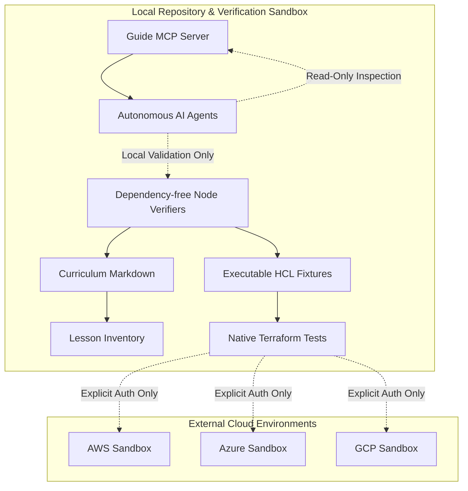

# Architecture

System architecture and engineering design for the Terraform Complete Guide and its integrated AI Engineering OS.

## Context

The Terraform Complete Guide provides an authoritative, modular, and verifiable curriculum for modern Infrastructure as Code (IaC) engineering targeting HashiCorp Terraform 1.14.x. It pairs pedagogical Markdown lessons with isolated, runnable HCL fixtures, native test harnesses, and an AI Engineering OS adapter that enables autonomous yet bounded pair-programming agents (such as Claude Code and Gemini CLI) to safely discover, plan, test, and maintain cloud infrastructure definitions.

## System boundaries

The architecture enforces distinct trust boundaries between documentation, verification automation, infrastructure fixtures, and external cloud environments:

- **Documentation & Inventory Boundary**: Public documentation is validated statically without network calls or external execution engines.
- **Fixture & State Boundary**: Terraform configurations execute in temporary, disposable sandboxes using local backends and `terraform_data` primitives to prevent accidental cloud mutations or secret leakage.
- **Agent Integration Boundary**: AI agents interact via bounded stdio MCP servers and CLI entry points with strictly enforced read-only policies and mandatory human approval gates for any external side effects.

## Components

The system consists of five primary architectural subsystems:

1. **Curriculum & Knowledge Base**:
   - Structured curriculum organized into 10 domains: `basics/`, `core-concepts/`, `state/`, `modules/`, `provisioners/`, `cloud-providers/`, `security/`, `testing/`, `cicd/`, and `best-practices/`.
   - Manifest catalog (`docs/lesson-inventory.json`) maintaining metadata, status, validation levels, and evidence chains.

2. **Verification & Testing Engine**:
   - `scripts/check-docs.mjs`: Validates document structure, code fences, heading hierarchy, link integrity, and inventory alignment.
   - `scripts/check-examples.mjs`: Validates `examples/manifest.json`, enforces native test fixtures, and executes `terraform test` in isolated scratch spaces.
   - `scripts/check-security.mjs`: Enforces bounded policy against credentials, private artifacts, workflow over-permissions, and supply-chain lockfile tampering.
   - `scripts/check-state-recovery.mjs`: Verifies state migration, loss simulation, backup restoration, and lineage preservation without cloud dependencies.
   - `scripts/check-local-lifecycle.mjs`: Verifies init, plan, apply, output inspection, idempotence, and destruction cycles.

3. **Model Context Protocol (MCP) Server**:
   - `scripts/guide-mcp.mjs`: A lightweight stdio JSON-RPC 2.0 MCP server exposing read-only tools (`search_lessons`, `read_lesson`, `current_status`) to AI assistants.

4. **AI Engineering OS & Provider Adapters**:
   - Provider-neutral contract (`core/OPERATING_SYSTEM.md`) defining engineering lifecycle, safety gates, and multi-agent coordination.
   - Provider-specific configuration adapters (`adapters/claude/`, `adapters/gemini/`, `.claude/`, `.gemini/`).
   - Durable project state (`project-memory/`) retaining context across sessions.

5. **CI/CD Quality Gate**:
   - GitHub Actions workflow (`.github/workflows/docs.yml`) executing multi-OS (Ubuntu, Windows) and multi-node test matrices, Actionlint workflow validation, and local Terraform lifecycle tests.

## Data flows

The primary execution and information flows operate as follows:

1. **Documentation Verification Flow**:
   - Markdown files -> `stripFences` -> heading anchor extraction -> reference & local link resolution -> inventory schema validation -> exit code 0 or error diagnostics.

2. **Terraform Fixture Lifecycle Flow**:
   - Source fixture in `examples/` -> filtered copy to OS temp directory -> `terraform init` -> `terraform test -json` -> output assertion -> complete directory cleanup.

3. **State Disaster Recovery Flow**:
   - Local fixture creation -> initial state apply -> `state pull` backup -> backend re-initialization with `-migrate-state` -> simulated file deletion -> `state push` restoration -> `plan -detailed-exitcode` verification -> clean teardown.

4. **MCP Query Flow**:
   - Agent client -> stdio JSON-RPC request -> parameter validation against JSON schema -> path traversal sanitization -> file retrieval & excerpt generation -> JSON-RPC result.

## Interfaces

| Interface | Protocol / Type | Inputs | Outputs | SLA / Security Level |
| --- | --- | --- | --- | --- |
| `scripts/guide-mcp.mjs` | JSON-RPC 2.0 over stdio | Tool requests (`search_lessons`, `read_lesson`, `current_status`) | Tool responses with Markdown excerpts or text | Read-only, memory-bounded, zero secrets |
| `scripts/check-docs.mjs` | CLI / Node.js | File paths, repository root | Exit code 0/1, console diagnostic logs | Offline, deterministic, zero network dependencies |
| `scripts/check-examples.mjs` | CLI / Terraform CLI | Manifest path, temp directory | Test pass/fail reports, JSON test outputs | Isolated temporary directory, zero credentials |
| GitHub Actions CI | Webhook / Git push | Commit SHA, pull request metadata | CI check status, matrix pass/fail | Least privilege (`contents: read`), pinned commits |

## Deployment topology

The Terraform Complete Guide repository is deployed in two tiers:

1. **Repository & Local Workspace Topology**:
   - Standalone Git repository executable on Windows, macOS, and Linux.
   - Node.js runtime (pinned in `.node-version`) and Terraform CLI (1.14.x) running locally.
   - Local temp directory (`os.tmpdir()`) utilized for all dynamic test fixtures.

2. **Continuous Integration Topology**:
   - GitHub Actions virtual environments: `ubuntu-latest` and `windows-latest`.
   - Action runners provisioned with pinned tool versions (`actions/checkout`, `actions/setup-node`, `hashicorp/setup-terraform`).
   - Actionlint runner installed on Ubuntu for workflow syntax validation.

## Key quality attributes

- **Security by Default**: Zero credentials checked into Git; automated scans reject `.tfvars`, `.tfstate`, private keys, and cloud API tokens.
- **Portability**: All core scripts are written using Node.js standard libraries with path normalization for Windows and POSIX systems.
- **Reproducibility**: Dependency-free verification scripts guarantee identical test behavior across local developer workstations and remote CI environments.
- **Traceability**: All claims, tests, and roadmap tasks are evidenced by explicit markdown records in `docs/` and tracked in `docs/execution-progress.json`.

## Open questions

1. **Hosted CI Execution**: Verification currently executes on local Windows environments; remote GitHub Actions runs need initial trigger and verification once pushed.
2. **Multi-Cloud Live Lab Sandboxes**: Live cloud execution for AWS, Azure, and GCP requires dedicated ephemeral subscription/account credentials under human supervision.
3. **Static Documentation Generator**: Choice of MkDocs Material vs Astro vs Starlight for public documentation publishing in Phase 7.
