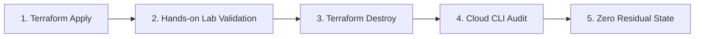

# Cloud Lab Operational Contracts and Safety Boundaries

## Overview and objectives

This contract establishes the mandatory operational rules, budget controls, safety guardrails, and teardown verification protocols governing all cloud sandbox environments across the repository.

Reference cloud lab implementations governed by this specification:
- [AWS Cloud Lab](../examples/cloud-labs/aws/README.md)
- [Azure Cloud Lab](../examples/cloud-labs/azure/README.md)
- [GCP Cloud Lab](../examples/cloud-labs/gcp/README.md)

Each lab targets Terraform `~> 1.14.0` and enforces strict cost baselines, explicit attribution tags, and deterministic teardown.

## Cloud sandbox prerequisite checks

Before deploying any infrastructure code to a cloud environment, engineers must verify the following three prerequisite checkpoints:

### 1. Identity and credential isolation

- **Zero Long-Lived Static Keys**: Never commit, store, or use long-lived root or IAM user access keys (`AKIA...`), service account JSON keyfiles, or Azure client secrets in local files or Git repositories.
- **Temporary Federation**:
  - AWS: Use AWS IAM Identity Center (SSO) via `aws sso login` or temporary STS credentials.
  - Azure: Authenticate interactively with `az login` or use Microsoft Entra ID Workload Identity Federation in automated CI.
  - GCP: Use Application Default Credentials (ADC) with `gcloud auth application-default login` or Workload Identity Federation (WIF).
- **Scope Restriction**: Lab execution accounts must be restricted to non-production sandbox accounts, subscriptions, or projects.

### 2. Budget alerts and billing guardrails

Every sandbox subscription or project must have hard billing boundaries established before running `terraform apply`:

| Provider | Threshold | Mechanism | Required Action on Alert |
| --- | --- | --- | --- |
| AWS | \$5.00 USD / month | AWS Budgets + Amazon SNS | Immediate notification to engineer and automated runbook trigger |
| Azure | \$5.00 USD / month | Azure Cost Management Budgets + Action Groups | Immediate email alert and resource cap notification |
| GCP | \$5.00 USD / month | Cloud Billing Budgets + Cloud Pub/Sub | Notification alert and quota throttling |

### 3. Regional and quota boundaries

- Deployments are restricted to designated training regions:
  - AWS: `us-east-1`
  - Azure: `eastus`
  - GCP: `us-central1`
- Cloud service quotas must prohibit the provisioning of high-cost compute (e.g., GPU instances, bare-metal nodes, or large database clusters) within the sandbox.

## Mandatory tagging and attribution contract

Every resource created by Terraform in cloud sandboxes must declare metadata tags or labels enabling automated cost tracking, lifecycle auditing, and sweeper accountability.

| Standard Tag Key | GCP Label Key | Allowed Values | Governance Purpose |
| --- | --- | --- | --- |
| `Environment` | `environment` | `sandbox`, `dev`, `test` | Prevents sandbox infrastructure from co-mingling with production workloads |
| `ManagedBy` | `managed_by` | `Terraform` | Identifies resources managed through Infrastructure as Code |
| `CostCenter` | `cost_center` | `training` | Maps cloud consumption directly to educational training budgets |
| `Owner` | `owner` | Engineer handle (default: `cloud-lab-user`) | Identifies individual accountable for resource destruction |

Provider-specific tagging rules:
- **AWS**: Tags are declared via provider-level `default_tags` and resource-level `tags = local.mandatory_tags`.
- **Azure**: Tags are passed explicitly to the `azurerm_resource_group` and child resources via `tags = local.mandatory_tags`.
- **GCP**: Google Cloud labels must be strictly lowercase alphanumeric strings with underscores or hyphens. Cloud labs declare both `mandatory_tags` for governance and `mandatory_labels` for Google Cloud API compatibility.

## Multi-cloud cost comparison and safety boundaries

Foundational cloud labs in this repository are engineered to operate strictly within the free-tier or lowest-cost tier available on each major cloud provider.

### Resource comparison matrix

| Dimension | AWS Lab (`examples/cloud-labs/aws`) | Azure Lab (`examples/cloud-labs/azure`) | GCP Lab (`examples/cloud-labs/gcp`) |
| --- | --- | --- | --- |
| Target Resource | `aws_s3_bucket` | `azurerm_storage_account` | `google_storage_bucket` |
| Grouping Construct | Global S3 namespace | `azurerm_resource_group` (`rg-tflab-sandbox`) | GCP Project namespace |
| Storage Tier | Standard S3 | Standard LRS (Locally Redundant) | Standard Multi-Region (`US`) |
| Free-Tier Allowance | 5 GB storage, 20,000 GETs, 2,000 PUTs | 5 GB LRS blob storage | 5 GB-months storage, 5,000 Class A operations |
| Encryption Cost | SSE-S3 `AES256` (\$0.00/mo) | Microsoft-managed key (\$0.00/mo) | Google-managed key (\$0.00/mo) |
| Destroy Guarantee | `force_destroy = true` | Cascading resource group deletion | `force_destroy = true` |

### Explicitly banned high-cost lab resources

To protect learners from accidental cloud spending spikes, foundational labs strictly prohibit the following resource types unless explicitly required by advanced, specialized exercises:
- **Managed NAT Gateways**: AWS NAT Gateway, GCP Cloud NAT (~$32.00–\$35.00/month baseline idle charge).
- **Public Application / Network Load Balancers**: AWS ALB/NLB, Azure Application Gateway (~$20.00–\$40.00/month).
- **Idle Static Public IPs**: AWS Unassociated Elastic IPs, GCP Unattached Static IPs ($3.60–\$7.20/month).
- **Unattached Disks**: Detached EBS volumes, orphaned Azure Managed Disks, unattached GCP Persistent Disks.
- **Customer-Managed KMS Keys**: AWS KMS customer keys ($1.00/key/month) and Azure Key Vault managed HSMs.

## Automated teardown verification protocol

To ensure that no cloud resources outlive their exercise session, engineers must follow the 3-phase teardown protocol:



### Phase 1: Terraform destruction

Execute automated destruction from the lab directory:

```shell
terraform destroy -auto-approve
```

Verify that the CLI reports clean completion (e.g., `Destroy complete! Resources: 5 destroyed.`).

### Phase 2: Provider CLI residual audit

Query the cloud provider API directly to confirm that no resources remain active:

```shell
# AWS residual verification
aws s3 ls

# Azure residual verification
az resource list --resource-group rg-tflab-sandbox --output table

# GCP residual verification
gcloud storage buckets list --filter="name:tf-guide-lab"
```

### Phase 3: State file zero-resource confirmation

Confirm that the local or remote state file no longer tracks any provisioned objects:

```shell
terraform state list
```

An empty output confirms that state management matches cloud reality.

## Disaster recovery plan for orphaned resources

When standard `terraform destroy` fails due to network disconnections, API timeouts, or unmanaged object attachments, follow this recovery protocol:

### 1. Identify failure cause

| Failure Symptom | Underlying Cause | Immediate Remediation |
| --- | --- | --- |
| `BucketNotEmpty` / `ObjectExists` | Non-Terraform objects were written into the bucket | Ensure `force_destroy = true` or empty bucket via CLI before retrying |
| `DependencyViolation` | Network interfaces or subnets have active attachments | Identify and delete rogue network attachments |
| `AuthorizationFailed` / Expired Token | Session token expired during multi-step destroy | Re-authenticate (`aws sso login`, `az login`, `gcloud auth`) and resume |
| State lock timeout | Orphaned state lock from killed CLI session | Verify no other process is running, then unlock via `terraform force-unlock <LOCK_ID>` |

### 2. Manual purge instructions

If Terraform state is corrupted or lost:

```shell
# AWS S3 manual recursive purge and bucket deletion
aws s3 rb s3://<BUCKET_NAME> --force

# Azure cascading resource group deletion
az group delete --name rg-tflab-sandbox --yes --no-wait

# GCP storage bucket recursive deletion
gcloud storage rm --recursive gs://<BUCKET_NAME>
```

### 3. Automated sweeper runbook

For enterprise training accounts, configure scheduled daily sweeper scripts (e.g., AWS Nuke, Azure Sweeper, or Cloud Functions):
- Target only resources matching `Environment = "sandbox"` and `CostCenter = "training"`.
- Purge any resource with `CreationTimestamp` older than 12 hours.
- Notify the tagged `Owner` via enterprise messaging of automated sweeping actions.

## References and curriculum alignment

- [AWS Provider Curriculum](../cloud-providers/terraform-on-aws.md)
- [Azure Provider Curriculum](../cloud-providers/terraform-on-azure.md)
- [GCP Provider Curriculum](../cloud-providers/terraform-on-gcp.md)
- [Remote Backends and Locking Architecture](../state/remote-backends.md)
- [Security, IAM, and Secrets Management](../security/iam-and-policies.md)
