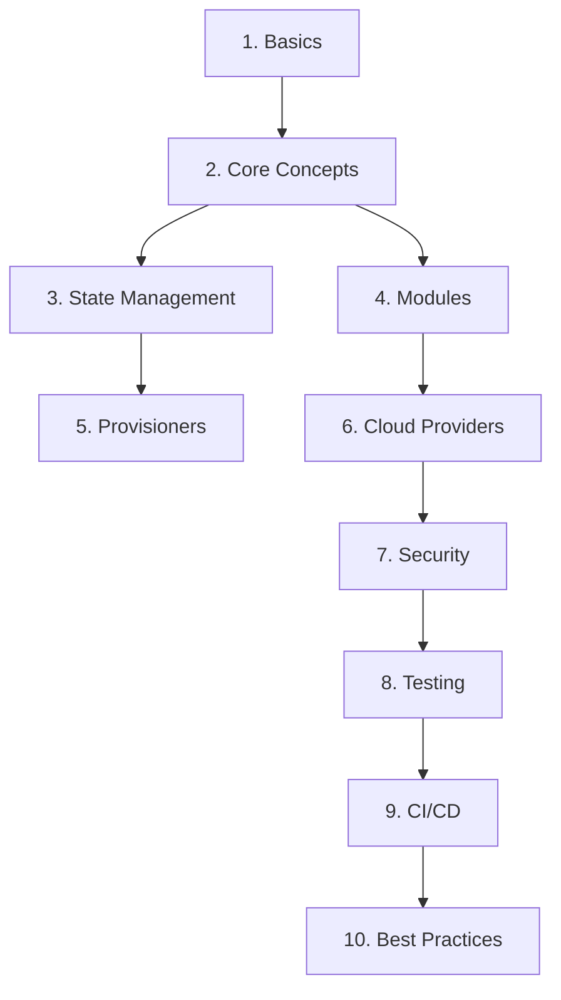

# Terraform Complete Guide

Welcome to the **Terraform Complete Guide**, an authoritative, modular, and verifiable curriculum for modern Infrastructure as Code (IaC) targeting HashiCorp Terraform 1.14.x.

## Curriculum overview

This guide provides 22 comprehensively reviewed lessons across 10 engineering domains. Every lesson pairs conceptual foundations with executable fixtures, offline validation gates, and clear boundary controls.



## Quick start and learning paths

Get started with zero cloud credentials using our deterministic local lab fixture:

- [Beginner learning path](learning-path.md): 5-step introductory progression through CLI basics and resource lifecycle.
- [Command reference](command-reference.md): Essential CLI commands, expected exit codes, and inspection patterns.
- [Terminology glossary](glossary.md): Core Terraform language concepts and architecture terms.
- [Local basics lab fixture](../examples/local-basics/README.md): Reproducible, zero-cloud HCL workspace using `terraform_data`.

```shell
# Verify your local environment and view the baseline CLI version
terraform version

# Initialize the local sandbox
terraform init

# Validate configuration consistency
terraform validate

# Inspect proposed resource changes
terraform plan
```

## Curriculum domains

### Foundations
- [Introduction and installation](../basics/intro-and-installation.md): Installation workflows, CLI baseline, and lifecycle stages.
- [File structure and syntax](../basics/file-structure-and-syntax.md): Directory-as-module semantics, root module layouts, and HCL blocks.
- [Providers and resources](../core-concepts/providers-and-resources.md): Provider plugins, resource address schemes, and dependency graphs.
- [Variables and outputs](../core-concepts/variables-and-outputs.md): Strongly typed inputs, validation rules, and exposed outputs.
- [Expressions, iteration and lifecycle](../core-concepts/expressions-and-lifecycle.md): For-expressions, splat syntax, dynamic blocks, and lifecycle meta-arguments.

### State and modularity
- [State management and recovery](../state/state-management.md): Disaster recovery drills, state inspection, and lineage protection.
- [Remote backends and state boundaries](../state/remote-backends.md): S3, Azure Blob, and GCS backends with atomic locking and access boundaries.
- [Creating reusable modules](../modules/creating-modules.md): Modular interface encapsulation, composition patterns, and semantic versioning.
- [Using module registries and source types](../modules/module-registry.md): Terraform Registry, private module registries, and Git subpath sourcing.

### Orchestration and multi-cloud
- [File provisioner and connection blocks](../provisioners/file-and-connection.md): SSH/WinRM connection parameters and artifact staging trade-offs.
- [Local-exec and remote-exec provisioners](../provisioners/local-and-remote-exec.md): Non-declarative escape hatches, failure modes, and lifecycle triggers.
- [Terraform on Amazon Web Services (AWS)](../cloud-providers/terraform-on-aws.md): AWS provider initialization, IAM authentication, and S3 backend locking.
- [Terraform on Microsoft Azure](../cloud-providers/terraform-on-azure.md): Azurerm provider patterns, OIDC workload identity, and Azure Blob storage backends.
- [Terraform on Google Cloud Platform (GCP)](../cloud-providers/terraform-on-gcp.md): Google provider configuration, ADC credentials, and Cloud Storage backends.

### Governance and continuous delivery
- [IAM and least privilege policy design](../security/iam-and-policies.md): Role boundaries, assume-role delegation, and credential scoping.
- [Secrets management in Terraform](../security/secrets-management.md): Sensitive variable masking, external secret engines, and ephemeral state handling.
- [Terraform validate, plan, and native tests](../testing/terraform-validate-and-plan.md): Static analysis, speculative execution, and `.tftest.hcl` suites.
- [Terratest and end-to-end testing](../testing/terratest.md): Automated Go integration test harnesses and cloud verification patterns.
- [Terraform CI/CD pipelines with GitHub Actions](../cicd/github-actions.md): Automated validation matrix, speculative plans, and OIDC runners.
- [Terraform automation with Azure DevOps pipelines](../cicd/azure-devops.md): Multi-stage approval pipelines, secure service connections, and artifact management.
- [Resource naming and tagging conventions](../best-practices/naming-conventions.md): Structured resource labelling, TFLint enforcement, and cost allocation tags.
- [Workspace strategy and environment isolation](../best-practices/workspace-strategy.md): CLI workspaces versus isolated directory roots and state safety.

## Verification and evidence

All documentation and fixtures are verified offline by automated test suites:

- [Curriculum verification evidence](curriculum-evidence.md): Audit trails, validation classifications, and test logs.
- [State security evidence](state-security-evidence.md): State recovery simulation logs and backend isolation tests.
- [Platform baseline evidence](phase2-evidence.md): Terraform 1.14.8 compatibility matrix and reproducibility records.
- [QA and CI verification evidence](qa-ci-evidence.md): CI/CD workflow security audit, test suite results, and offline verification proofs.
- [System architecture](ARCHITECTURE.md): Architectural design, security boundaries, and data flows.
- [Security policy](SECURITY.md): Threat modeling, credential scanning policies, and report workflows.
- [Operations manual](OPERATIONS.md): Operational procedures, site maintenance, and health checks.
- [Runbook](RUNBOOK.md): Incident handling, disaster recovery steps, and escalation guidelines.
- [Content standard](content-standard.md): Editorial guidelines, HCL style rules, and verification standards.
