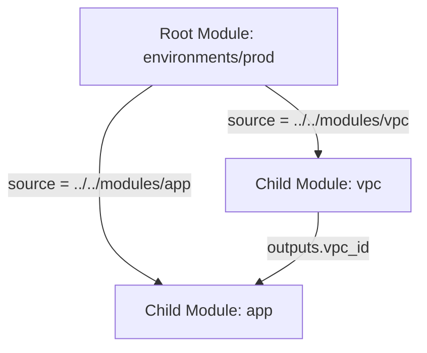

# Creating reusable modules

## Objectives and prerequisites

Learn how to structure, parameterize, validate, and invoke reusable child modules in Terraform. Prerequisites: [file structure and syntax](../basics/file-structure-and-syntax.md), [variables and outputs](../core-concepts/variables-and-outputs.md), and the [local basics lab](../examples/local-basics/README.md).

## Module design and file structure

A Terraform module is a self-contained collection of `.tf` files in a dedicated directory. Every root configuration is itself a module (the root module), and can instantiate other modules (child modules).

Recommended module directory layout:

| File | Purpose |
| --- | --- |
| `main.tf` | Core resource and data source definitions |
| `variables.tf` | Input declarations with explicit types, descriptions, and validation |
| `outputs.tf` | Values exposed to calling modules |
| `versions.tf` | Minimum required Terraform CLI and provider versions |
| `README.md` | Interface documentation (inputs, outputs, requirements, examples) |



## Input variables, validation, and outputs

Always declare types, descriptions, and validation rules for input parameters to catch misconfigurations before execution:

```hcl
variable "environment" {
  type        = string
  description = "Target deployment environment (dev, staging, prod)."

  validation {
    condition     = contains(["dev", "staging", "prod"], var.environment)
    error_message = "Environment must be one of: dev, staging, prod."
  }
}

variable "instance_count" {
  type        = number
  description = "Number of instances to provision."
  default     = 1

  validation {
    condition     = var.instance_count > 0 && var.instance_count <= 10
    error_message = "Instance count must be between 1 and 10."
  }
}
```

Expose only relevant resource attributes through outputs. Document output descriptions and mark sensitive outputs appropriately:

```hcl
output "service_name" {
  value       = terraform_data.service.input.name
  description = "The canonical service name generated by the module."
}
```

## Reusability and calling conventions

Child modules are called from the parent module using a `module` block:

```hcl
module "service" {
  source = "./modules/service"

  environment    = "dev"
  instance_count = 2
}
```

Key rules for child modules:
1. **Never hardcode provider configurations**: Let the root module pass down provider instances. Child modules should declare requirements in `versions.tf` without root-level `provider` configuration blocks.
2. **Never configure backends in child modules**: The `backend` block belongs strictly in the root module.
3. **Use semantic versioning**: For shared or registry-hosted modules, always pin module versions (`version = "~> 2.1.0"`).

## Exercise and expected result

Create a local child module directory structure and test module invocation:

```shell
mkdir -p scratch/modules/app
```

Add a resource in `scratch/modules/app/main.tf`:

```hcl
variable "app_name" {
  type        = string
  description = "Application name"
}

resource "terraform_data" "app" {
  input = {
    name = var.app_name
  }
}

output "app_id" {
  value = terraform_data.app.id
}
```

Call the module from the root `scratch/main.tf` and run:

```shell
terraform init
terraform validate
```

Expect `Success! The configuration is valid.` Rationale: `terraform init` scans child module references and establishes internal module metadata in `.terraform/modules/`.

## Troubleshooting and cleanup

| Symptom | Cause | Remediation |
| --- | --- | --- |
| `Module not installed` | Calling a new module without re-initializing | Run `terraform init` to index the module source |
| `Unsupported argument` | Passing a parameter not declared in `variables.tf` | Verify child module input variable definitions |
| `Missing required argument` | Variable has no default and was not provided | Supply the required argument in the `module` block |

Clean up any temporary scratch directories after completing the exercise.

## References and verification

Reviewed 2026-10-11 for Terraform 1.14.8; see [curriculum evidence](../docs/curriculum-evidence.md).
- [Terraform Module Standard Structure](https://developer.hashicorp.com/terraform/language/modules/develop/structure)
- [Module Sources](https://developer.hashicorp.com/terraform/language/modules/sources)
- [Input Variables](https://developer.hashicorp.com/terraform/language/values/variables)