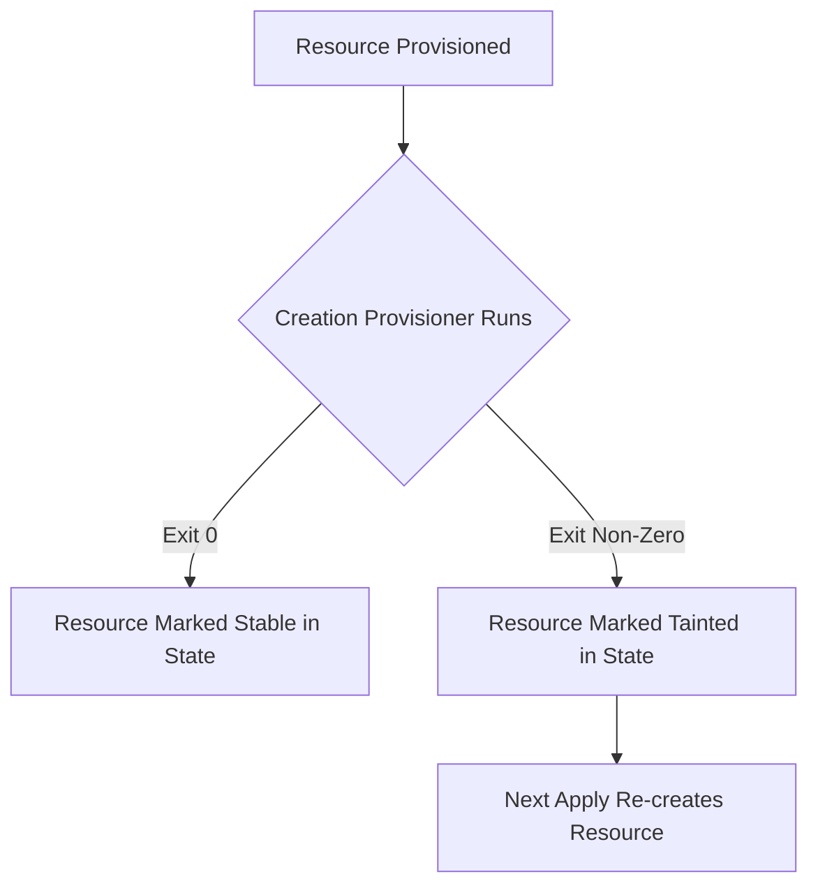

# Local-exec and remote-exec provisioners

## Objectives and prerequisites

Understand the purpose, failure semantics, security risks, and modern alternatives to `local-exec` and `remote-exec` provisioners in Terraform. Prerequisites: [providers and resources](../core-concepts/providers-and-resources.md) and [local basics lab](../examples/local-basics/README.md).

## The role and risks of provisioners

Provisioners are considered a **last resort** in Terraform. They execute arbitrary commands either locally on the machine running Terraform (`local-exec`) or remotely on a provisioned server (`remote-exec`).

Why provisioners should be minimized:
1. **Imperative vs. Declarative**: Provisioners run commands imperatively; they break idempotency and state drift tracking.
2. **Fragile State Lifecycle**: If a creation provisioner fails, Terraform marks the entire resource as **tainted**, scheduling it for replacement on the next apply.
3. **Security Risks**: Passing unsanitized variables into shell commands risks shell injection attacks.
4. **Network & Credential Burdens**: `remote-exec` requires SSH/WinRM connectivity, bastion host orchestration, and long-lived private keys.



## Local-exec provisioner usage

`local-exec` executes a shell command locally on the system where Terraform is executed:

```hcl
resource "terraform_data" "notify" {
  input = "deployment-event"

  provisioner "local-exec" {
    command = "echo Deployment event recorded for ${self.input} >> deployment.log"
  }
}
```

By default, provisioners run on creation. To execute cleanup logic when a resource is deleted, specify `when = destroy`:

```hcl
resource "terraform_data" "session" {
  input = "session-123"

  provisioner "local-exec" {
    when    = destroy
    command = "echo Session ${self.input} destroyed"
  }
}
```

## Remote-exec provisioner usage

`remote-exec` connects over SSH or WinRM to execute shell commands directly on a provisioned compute instance:

```hcl
resource "terraform_data" "remote_bootstrap" {
  # Requires connection block configured with host, user, and credentials
  provisioner "remote-exec" {
    inline = [
      "sudo apt-get update -y",
      "sudo apt-get install -y nginx"
    ]
  }
}
```

## Native alternatives to provisioners

In modern cloud architecture, replace provisioners with cloud-native configuration management:
- **Cloud-init / User Data**: Use EC2 `user_data`, Azure `custom_data`, or GCP `metadata_startup_script` to bootstrap virtual machines natively without SSH tunnels.
- **Image Baking**: Use HashiCorp Packer to build pre-configured machine images (AMIs, VHDs) before provisioning.
- **Managed APIs**: Use Kubernetes operators, Helm providers, or cloud platform APIs instead of running CLI scripts locally.

## Exercise and expected result

Experiment with `terraform_data` and a simple creation `local-exec` in a test directory:

```shell
terraform init
terraform apply -auto-approve
```

Verify that the provisioner command executed and its output was logged to the terminal. Run `terraform destroy` and verify that destruction completed.

Rationale: Understanding that provisioners only run during resource creation/destruction—not on routine updates—is critical for avoiding configuration drift.

## Troubleshooting and cleanup

| Symptom | Cause | Remediation |
| --- | --- | --- |
| `Resource marked as tainted` | Provisioner exited with a non-zero exit code | Set `on_failure = continue` if the step is non-fatal, or fix the command |
| `Cannot connect to host via SSH` | Security group blocks port 22 or host key mismatch | Verify network path and SSH keys; prefer cloud-init over `remote-exec` |
| `Command not found` on Windows | Shell default difference between `powershell` and `cmd` | Specify `interpreter = ["powershell", "-Command"]` explicitly |

## References and verification

Reviewed 2026-10-11 for Terraform 1.14.8; see [curriculum evidence](../docs/curriculum-evidence.md).
- [Terraform Provisioners Overview](https://developer.hashicorp.com/terraform/language/resources/provisioners/syntax)
- [local-exec Provisioner](https://developer.hashicorp.com/terraform/language/resources/provisioners/local-exec)
- [remote-exec Provisioner](https://developer.hashicorp.com/terraform/language/resources/provisioners/remote-exec)