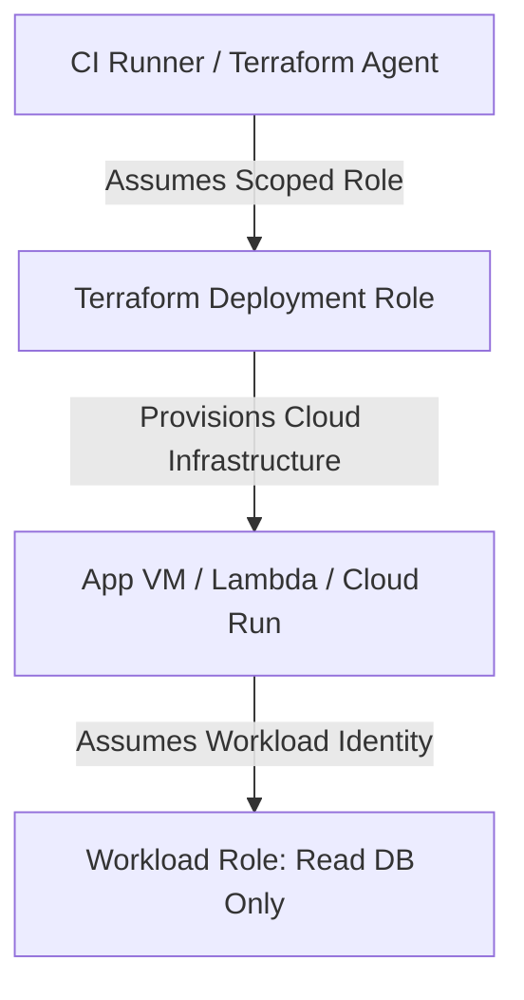

# IAM and least privilege policy design

## Objectives and prerequisites

Design declarative Identity and Access Management (IAM) roles, implement least privilege access for Terraform execution identities, and enforce Policy as Code guardrails. Prerequisites: [providers and resources](../core-concepts/providers-and-resources.md) and [secrets management](secrets-management.md).

## IAM architecture in Infrastructure as Code

When deploying infrastructure, two distinct IAM identities must be isolated:
1. **Pipeline / Runner Identity**: The identity used by the CI/CD agent executing `terraform plan` and `terraform apply`.
2. **Workload Identity**: The identity assigned to the resources being provisioned (e.g., EC2 Instance Profile, Kubernetes ServiceAccount, Azure Managed Identity).



Never reuse administrative personal credentials or wide wildcard permissions (`*.*`) for deployment automation.

## Principle of least privilege

Separate permissions by environment and lifecycle stage:
- **Plan Stage (Read-Only)**: The identity running `terraform plan` needs read/list access to cloud resources and read access to the state backend. It does not require resource creation or modification permissions.
- **Apply Stage (Scoped Write)**: The identity running `terraform apply` is restricted to the specific resource types and network subnets being managed.
- **State Storage Identity**: State bucket permissions should be scoped strictly to the deployment role, preventing general application workloads from accessing state files.

## Declarative policy authoring

Prefer native policy data sources over raw JSON strings to catch syntax errors during validation:

```hcl
data "aws_iam_policy_document" "s3_read" {
  statement {
    sid       = "AllowAppBucketRead"
    actions   = ["s3:GetObject", "s3:ListBucket"]
    resources = [
      "arn:aws:s3:::app-storage-bucket",
      "arn:aws:s3:::app-storage-bucket/*"
    ]
  }
}
```

This ensures:
- Proper escaping of ARNs and resource identifiers.
- Mergeable statements across modules using `source_policy_documents` or `override_policy_documents`.
- Early linting of invalid actions via provider schemas.

## Policy as code and automated guardrails

Automate security enforcement before `terraform apply` using Policy as Code tools:
- **Open Policy Agent (OPA) / Rego**: Validates `terraform plan -json` output against compliance rules (e.g., mandate encryption on all storage buckets).
- **HashiCorp Sentinel**: Enterprise policy framework for enforcing tagging, network perimeter constraints, and cost limits.
- **Checkov / Trivy**: Scans static HCL files for common CVEs and security antipatterns before commit.

## Exercise and expected result

Validate an IAM policy document definition using Terraform:

```shell
terraform fmt -check
terraform validate
```

Verify that all policy statements specify:
1. Explicit `actions` (no unbounded `*` actions).
2. Explicit `resources` (no unbounded `*` resource targets).
3. Explicit `effect` (`Allow` or `Deny`).

Rationale: Unbounded IAM permissions significantly expand the blast radius of compromised deployment credentials.

## Troubleshooting and cleanup

| Symptom | Cause | Remediation |
| --- | --- | --- |
| `AccessDenied: User is not authorized to perform sts:AssumeRole` | Runner identity lacks trust relationship in IAM role trust policy | Update the role's `Principal` trust policy to include the CI runner OIDC subject |
| `MalformedPolicyDocument` | Invalid JSON syntax or unsupported IAM action | Use data source policy documents (`aws_iam_policy_document`) instead of raw JSON |
| State access denied during `terraform init` | Deployment role lacks data-plane permissions on state storage | Grant `s3:GetObject`/`s3:PutObject` on S3 or `Storage Blob Data Contributor` on Azure |

## References and verification

Reviewed 2026-10-11 for Terraform 1.14.8; see [curriculum evidence](../docs/curriculum-evidence.md).
- [AWS IAM Policy Document Data Source](https://registry.terraform.io/providers/hashicorp/aws/latest/docs/data-sources/iam_policy_document)
- [Least Privilege Best Practices](https://docs.aws.amazon.com/IAM/latest/UserGuide/best-practices.html#grant-least-privilege)
- [Open Policy Agent for Terraform](https://www.openpolicyagent.org/docs/latest/terraform/)