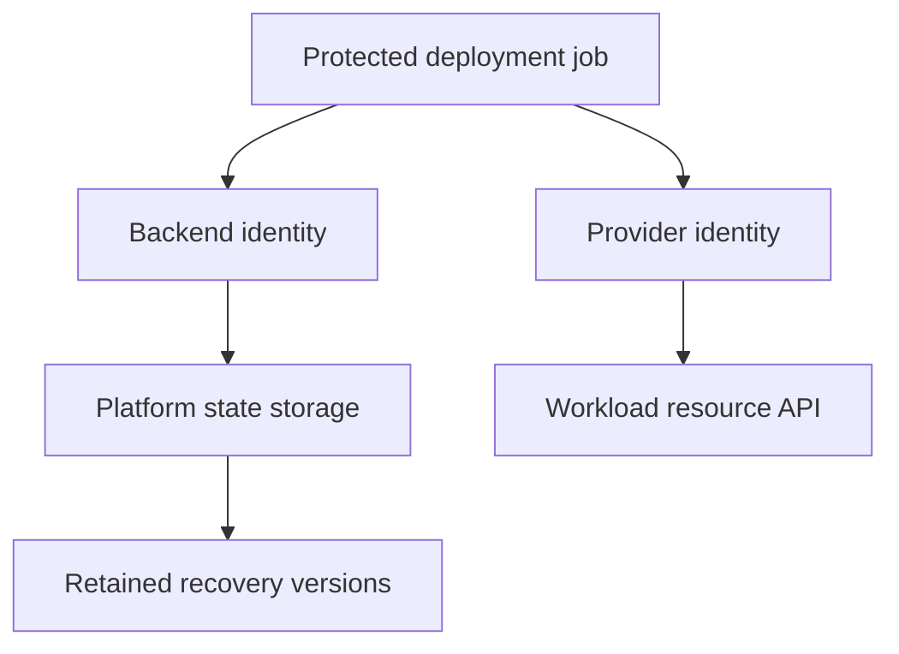

# Remote backends and organizational state boundaries

## Objectives and prerequisites

Choose state storage, separate backend authentication from provider authentication, and define verifiable recovery. Prerequisites: [state management](state-management.md), Terraform 1.14.x, a state owner and pre-existing storage for any live pilot. Review date: 2026-10-05; [evidence](../docs/state-security-evidence.md). Cloud instructions are reference guidance, not executed tests.

## Architecture and selection

The backend initializes before provider configuration is usable. A provider's role, subscription or impersonation configuration does not automatically configure backend access. Storage can live in a separate security account; document both identities.

| Backend | Placement | Locking | Required organizational controls |
| --- | --- | --- | --- |
| S3 | Bucket and object key | Opt-in lockfile | Versioning, encryption, state and lock permissions |
| AzureRM | Account, container, blob key | Native blob lease | Entra data-plane access and reachable storage |
| GCS | Bucket and prefix | Backend locking | Versioning, scoped access and ADC/federation |
| Local | Machine file | Local coordination | Disposable learning or controlled bootstrap |

Split state by ownership, permissions and release cadence. An organization-wide state increases blast radius and contention; one state per tiny object increases coordination. Start with environment plus platform service: network foundations, identity and application stacks each have a root. Publish non-secret contracts instead of granting every consumer full state access.



## Lab and expected outcomes

Run the cloud-free prerequisite from the repository root, in either shell:

```shell
node scripts/check-state-recovery.mjs
```

Expect migration, restoration, no-change plan and cleanup to pass. Follow the [backend configuration guide](../examples/backends/README.md) for exact partial fields and pilot requirements. Backend blocks cannot use ordinary input variables. Never put access keys or tokens in backend configuration: initialization metadata and plans may retain them.

For an approved remote pilot, use a dedicated empty key and a disposable `terraform_data` root. Record identity scope, version retention, runner connectivity, initialization, controlled apply and destroy, and final address inventory. Test contention with two coordinated sessions and a bounded `-lock-timeout`; record the operation that acquired the lock rather than assuming every command holds one. Restore a previous version under a writer freeze and reconcile IDs. These are pending cloud acceptance tests.

## Diagnosis, reliability and rollback

| Symptom | Inspect | Remediation |
| --- | --- | --- |
| Init denied but provider login works | Backend identity and scope | Correct the storage principal |
| Azure Contributor cannot read state | Data-plane role | Scope approved blob data role to container |
| Gcloud succeeds, backend fails | CLI credentials versus ADC | Establish approved ADC source |
| S3 state works, lock fails | Key plus `.tflock` permissions | Grant lock read/write/delete |
| Private runner cannot connect | DNS, proxy, firewall, private endpoint | Repair approved network route |
| Many jobs wait | Broad state or duplicate scheduling | Serialize per state; split only by justified boundary |

Use pipeline concurrency keyed by state identity and alerts for failed/stale runs. Do not disable locking to reduce queue time. Rollback requires a writer freeze, verified prior location/version, deliberate initialization and reconciliation before apply; reverting code alone is insufficient.

## Cleanup and exercise

The local harness cleans itself. For cloud pilots, destroy pilot resources, inspect empty state, and let the storage owner remove dedicated objects/versions under retention policy. Shared storage is never lab cleanup; retained versions can remain billable.

Exercise: design state access for development and production teams. Include two identity scopes, keys, network access and recovery owners. **Rationale:** different keys without different permissions are labels, not security boundaries. Require a negative test proving development cannot read production state.

## References and versions

Targets Terraform 1.14.x; local recovery uses 1.14.8. No cloud authentication, contention or restoration has been executed.

- [S3 1.14](https://developer.hashicorp.com/terraform/language/v1.14.x/backend/s3)
- [AzureRM 1.14](https://developer.hashicorp.com/terraform/language/v1.14.x/backend/azurerm)
- [GCS 1.14](https://developer.hashicorp.com/terraform/language/v1.14.x/backend/gcs)
- [Backend configuration 1.14](https://developer.hashicorp.com/terraform/language/v1.14.x/backend)
