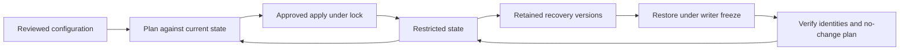

# State management and recovery

## Objectives and prerequisites

Protect resource identity, migrate state deliberately, and recover without creating duplicate infrastructure. Prerequisites: Terraform 1.14.x, Node.js, a checkout, and the [local basics lab](../examples/local-basics/README.md). This lab needs no cloud identity or budget. Review date: 2026-10-05; [evidence](../docs/state-security-evidence.md).

## State lifecycle

Configuration describes intent; state associates Terraform addresses with existing object IDs. Losing state does not delete those objects. Applying against empty state can create duplicates or fail on existing names. Assign a state owner, backend location, recovery objective, retention policy and recovery approver per root.



| Operation | Appropriate use | Safeguard |
| --- | --- | --- |
| `state list` / `state show` | Inspect ownership and identity | Restricted terminal |
| `state pull` | Recovery snapshot | Encrypted, restricted destination |
| `init -migrate-state` | Move existing state | Freeze writers; verify backup and destination |
| `init -reconfigure` | Accept configuration without copying state | Confirm intended state exists there |
| Declarative `moved` block | Rename managed address | Plan preserves remote object |
| Import block | Adopt existing object | Match configuration and review updates |
| `state push` | Exceptional restoration | Check lineage, serial and object identities |

State is not an infrastructure backup: database contents, disks and application data need their own recovery procedures. Object versioning requires retention and restore testing before claiming an RPO or RTO.

## Lab: migrate, lose, restore

From the repository root, both PowerShell and POSIX shells:

```shell
terraform version
node scripts/check-state-recovery.mjs
```

The [canonical harness](../scripts/check-state-recovery.mjs) creates a temporary root using only `terraform_data`. It applies one record, pulls a snapshot, migrates between two local state paths, simulates state-file loss, restores the snapshot, checks lineage/resource data, and requires a no-change plan. Expect `PASS local migration and loss/restore` and `PASS cleanup`. This proves local behavior only, not remote locks, IAM or cloud disaster recovery.

For a real migration, stop scheduled and manual writers; identify the exact backend/workspace; capture a restricted snapshot; secure the destination separately; change the backend declaration; run `terraform init -migrate-state` interactively; inspect `terraform state list`; then review `terraform plan -detailed-exitcode`. Exit 0 means no difference, 2 means changes to investigate, and 1 means failure. Do not copy the harness's disposable-only `-force-copy` shortcut into an organization migration. Keep the old backend read-only through the rollback window.

## Failure and recovery

1. Freeze writers and preserve restricted state versions and incident logs.
2. Confirm root, account, backend object and workspace. Empty state may mean a wrong location.
3. Select a known-good version and compare lineage, serial and resource IDs. A newer serial can contain legitimate changes.
4. Restore through the backend's approved version procedure or reviewed `state push`. Do not routinely bypass serial/lineage safeguards with `-force`.
5. Reconcile the cloud inventory and plan before allowing any apply.
6. Record actual recovery time/data loss and obtain the incident owner's release of the freeze.

A lock timeout does not establish a stale lock. Find the holder and running job first. Use `terraform force-unlock LOCK_ID` only after establishing that no writer remains. Never delete a lock to accelerate concurrent applies. If harness cleanup fails, inspect the reported isolated fixture path before removing it.

## Cleanup and exercise

The harness destroys its local record and removes its verified temporary directory. Migration cleanup means retiring the old backend after the recovery window, not destroying workloads. Retain snapshots under the data policy.

Exercise: migration is followed by a plan recreating every object. Should you apply? **Rationale:** stop; verify the backend key, workspace, account and address inventory. Applying against wrong or missing state risks duplicate infrastructure. Explain why the local drill cannot certify a cloud restore procedure.

## References and tested versions

Local execution: Terraform 1.14.8; backend guidance targets 1.14.x. CLI references are rolling documentation.

- [Terraform 1.14 state](https://developer.hashicorp.com/terraform/language/v1.14.x/state)
- [State push safeguards](https://developer.hashicorp.com/terraform/cli/commands/state/push)
- [Init migration flags](https://developer.hashicorp.com/terraform/cli/commands/init)
