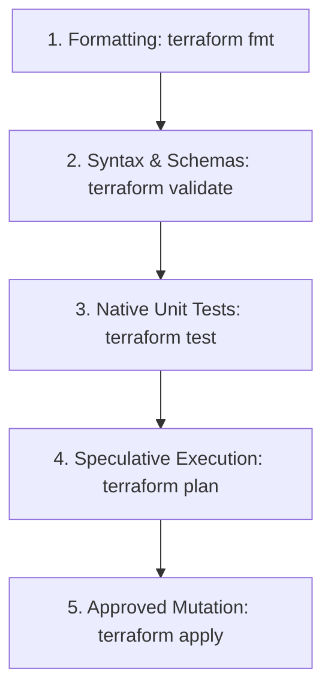

# Terraform validate, plan, and native tests

## Objectives and prerequisites

Understand the multi-stage verification hierarchy in Terraform, leverage `terraform fmt`, `validate`, and `plan -detailed-exitcode`, and author native integration tests using `.tftest.hcl`. Prerequisites: [intro and installation](../basics/intro-and-installation.md) and [local basics lab](../examples/local-basics/README.md).

## Verification layers in Terraform

Terraform provides four progressive levels of verification before mutating real-world infrastructure:



| Check | What It Proves | External Requirements | Speed |
| --- | --- | --- | --- |
| `fmt -check` | Canonical code styling and alignment | None | Instant (< 1s) |
| `validate` | Syntactic correctness and argument schemas | Provider plugins (`init`) | Very fast (1–2s) |
| `test` | Unit and integration assertions against modules | Mocked or local providers | Fast (2–10s) |
| `plan` | Actual state diff against live cloud APIs | Cloud credentials & state lock | Moderate (10–60s) |

## Static syntax validation: fmt and validate

1. **Formatting**:
   ```shell
   terraform fmt -check -recursive
   ```
   Ensures uniform indentation, argument alignment, and style across all `.tf` files.
2. **Schema Validation**:
   ```shell
   terraform validate
   ```
   Verifies resource block schemas, required arguments, type compatibility, and attribute references without contacting cloud APIs.

## Speculative execution: terraform plan

`terraform plan` compares the declarative HCL configuration against the recorded state and refreshes live cloud resource attributes:

```shell
terraform plan -out=tfplan.binary -detailed-exitcode
```

Understanding exit codes:
- `0`: Plan succeeded; **zero changes** required (configuration matches infrastructure).
- `1`: Plan encountered an execution error or failure.
- `2`: Plan succeeded; **infrastructure changes exist** (diff detected).

In CI/CD, always save plans using `-out=path` and apply that exact binary file (`terraform apply tfplan.binary`) to prevent race conditions or unexpected diffs between planning and applying.

## Native test framework: tftest.hcl

Starting with Terraform 1.6+, Terraform includes a built-in native testing framework using `.tftest.hcl` files stored in a `tests/` directory:

```hcl
# tests/service.tftest.hcl
variables {
  environment = "dev"
}

run "validate_service_naming" {
  command = plan

  assert {
    condition     = output.service_name == "service-dev"
    error_message = "Service name does not match expected convention."
  }
}
```

The native test framework supports:
- `command = plan`: Executes speculative checks without creating real infrastructure.
- `command = apply`: Creates real resources, runs assertions, and automatically tears down the fixture afterwards.
- Provider mocking: Override external cloud calls using synthetic providers for rapid unit testing.

## Exercise and expected result

Run the native test suite in the local basics example:

```shell
cd examples/local-basics
terraform test -json
```

Observe the JSON output streams showing test run events, assertions passed, and the final `test_summary` status `pass`.

Rationale: Native tests provide rapid feedback on module contracts and inputs without requiring Go, Python, or external testing harnesses.

## Troubleshooting and cleanup

| Symptom | Cause | Remediation |
| --- | --- | --- |
| `Error: Reference to undeclared input variable` | Variable used in test block is not in `variables.tf` | Declare the variable or correct the parameter name |
| `Assertion failed` in test run | Resource output does not match expected test condition | Inspect output value in plan/apply and update condition or HCL logic |
| `terraform validate` fails before `init` | Provider schemas not cached | Run `terraform init` to download provider schemas into `.terraform/` |

## References and verification

Reviewed 2026-10-11 for Terraform 1.14.8; see [curriculum evidence](../docs/curriculum-evidence.md).
- [Terraform Tests Guide](https://developer.hashicorp.com/terraform/language/tests)
- [terraform test Command](https://developer.hashicorp.com/terraform/cli/commands/test)
- [Detailed Exit Codes](https://developer.hashicorp.com/terraform/cli/commands/plan#detailed-exitcode)