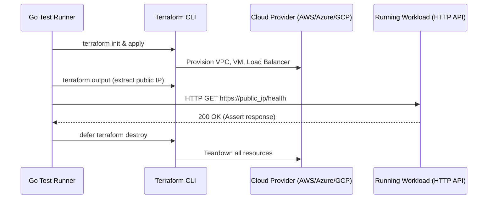

# Terratest and end-to-end infrastructure testing

## Objectives and prerequisites

Understand how Terratest enables real-world end-to-end infrastructure validation, evaluate when to use Go-based testing over native `.tftest.hcl`, and enforce reliable resource cleanup on test failure. Prerequisites: [terraform validate and plan](terraform-validate-and-plan.md) and [creating modules](../modules/creating-modules.md).

## What is Terratest

[Terratest](https://terratest.gruntwork.io/) is an open-source Go library developed by Gruntwork that allows automated testing of infrastructure code (Terraform, Packer, Docker, Helm, Kubernetes):
- It provisions real infrastructure via Terraform CLI automation.
- It performs end-to-end validation (e.g., sending HTTP requests to a deployed load balancer, checking SSH connectivity to a VM, or reading database tables).
- It tears down all provisioned resources using Go's `defer` statement.

## Terratest architecture and workflow

A typical Terratest lifecycle operates as follows:



## Native tests vs. Terratest

| Feature | Native Tests (`.tftest.hcl`) | Terratest (Go) |
| --- | --- | --- |
| **Language** | HCL (No external runtime needed) | Go (Requires Go toolchain `go test`) |
| **Execution Scope** | Unit tests, mock providers, basic apply | End-to-end integration and network validation |
| **External HTTP / Socket Probes** | Not supported | Fully supported (HTTP clients, SSH, SQL queries) |
| **Speed & Portability** | Very fast, zero dependencies | Slower, requires Go modules and compilation |
| **Recommended Use** | Standard module interface validation | Complex platform tracks and integration suites |

## Writing Go assertions and managing cleanup

Sample Terratest test case in Go:

```go
package test

import (
  "testing"
  "time"
  "github.com/gruntwork-io/terratest/modules/terraform"
  http_helper "github.com/gruntwork-io/terratest/modules/http-helper"
)

func TestWebServer(t *testing.T) {
  terraformOptions := terraform.WithDefaultRetryableErrors(t, &terraform.Options{
    TerraformDir: "../examples/web-server",
  })

  // Mandatory: ensure cleanup runs even if assertions fail
  defer terraform.Destroy(t, terraformOptions)

  terraform.InitAndApply(t, terraformOptions)

  endpoint := terraform.Output(t, terraformOptions, "endpoint_url")
  http_helper.HttpGetWithRetry(t, endpoint, nil, 200, "Hello World", 30, 5*time.Second)
}
```

Key rule: **Always register `defer terraform.Destroy` immediately before or after `terraform.InitAndApply`** to ensure orphaned cloud resources are deleted even if assertions fail or timeouts occur.

## Exercise and expected result

Evaluate test strategy trade-offs:
1. When is native `.tftest.hcl` preferred? Answer: For module interface contracts, variable validation, and local mock testing without cloud credentials.
2. When is Terratest justified? Answer: When validation requires sending live network traffic, authenticating to a deployed database, or exercising multi-tier service dependencies.

## Troubleshooting and cleanup

| Symptom | Cause | Remediation |
| --- | --- | --- |
| Orphaned cloud resources after failed test | Go test process was killed (`kill -9`) before `defer` executed | Tag resources with test run IDs; run automated sweeping scripts (e.g., `cloud-nuke`) |
| Flaky HTTP assertion failures | Application server still booting when check runs | Use retry helpers (`HttpGetWithRetry`) with reasonable backoff windows |
| Go build failure | Outdated Terratest dependencies or Go version mismatch | Run `go mod tidy` and verify Go version requirements |

## References and verification

Reviewed 2026-10-11 for Terraform 1.14.8; see [curriculum evidence](../docs/curriculum-evidence.md).
- [Terratest Documentation](https://terratest.gruntwork.io/)
- [Gruntwork Cloud Nuke](https://github.com/gruntwork-io/cloud-nuke)
- [Testing Best Practices](https://developer.hashicorp.com/terraform/language/tests)